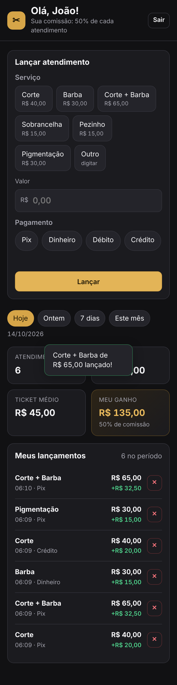
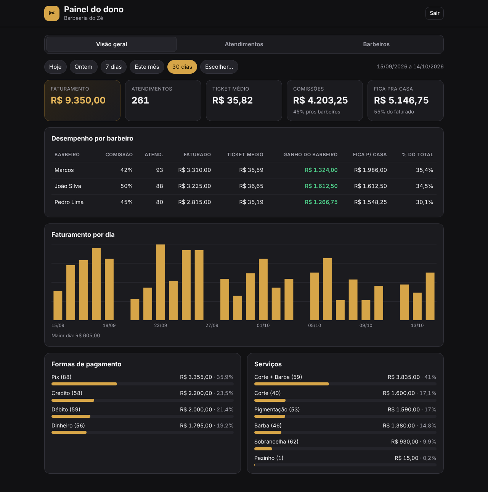

# Caixa da Barbearia ✂️

Sistema de caixa pra barbearia: cada barbeiro lança os próprios atendimentos e acompanha quanto ganhou,
e o dono tem um painel com todos os números da casa e o cadastro da equipe.

Não precisa instalar nenhuma dependência: roda só com o Node.js (versão 22.5 ou mais nova), usando o
SQLite que já vem com ele.

| Tela do barbeiro (celular) | Painel do dono |
| --- | --- |
|  |  |

## O que tem

**Tela do barbeiro** (`/barbeiro.html`), feita pra usar no celular
- Entra escolhendo o nome e digitando o PIN.
- Lança o atendimento em 3 toques: serviço (com preço sugerido), valor e forma de pagamento.
- Antes de lançar já mostra quanto ele vai ganhar naquele atendimento.
- Vê os números de hoje, ontem, 7 dias ou do mês: **atendimentos**, **faturado**, **ticket médio** e **meu ganho** (com a % de comissão).
- Pode excluir um lançamento errado, só do dia de hoje (dias anteriores só o dono mexe).

**Atualização automática**: as duas telas buscam os números de novo a cada 30 segundos e assim que
você volta pra elas (ex.: desbloqueou o celular). O cantinho do topo mostra "Atualizado HH:MM" com uma
bolinha verde, ou "Sem conexão" em vermelho se o servidor não responder.

**Painel do dono** (`/admin.html`)
- *Visão geral*: faturamento, atendimentos, ticket médio, total de comissões e quanto fica pra casa (com a margem em %).
- Tabela por barbeiro: comissão, atendimentos, faturado, ticket médio, ganho do barbeiro, quanto fica pra casa e % do faturamento total.
- Gráfico de faturamento por dia, divisão por forma de pagamento e por serviço.
- Filtro de período: hoje, ontem, 7 dias, este mês, 30 dias ou datas escolhidas.
- *Atendimentos*: lista de tudo que foi lançado, filtro por barbeiro, lançar pelo caixa e excluir.
- *Barbeiros*: cadastrar (nome, % de comissão, PIN), editar e excluir.

## Como rodar

```bash
ADMIN_PIN=4821 NOME_BARBEARIA="Barbearia do Zé" npm start
```

Abra `http://localhost:3000`, entre como **dono** com o PIN definido e cadastre os barbeiros na aba *Barbeiros*.
Cada barbeiro entra com o PIN que você cadastrou pra ele.

## Colocar na internet (Railway)

Assim cada barbeiro acessa do próprio celular, de qualquer lugar, e todo mundo vê o mesmo caixa.
O projeto já vem pronto pro Railway (`Dockerfile` + `railway.json`).

1. Crie uma conta em [railway.com](https://railway.com) entrando com o GitHub.
2. **New Project → Deploy from GitHub repo** e escolha `meu-servidor-saas` (branch `main`).
3. No serviço criado, aba **Variables**, adicione:
   - `ADMIN_PIN`: o PIN do dono. Use **6 números ou mais** (ex.: `482193`), já que o painel fica na internet.
   - `NOME_BARBEARIA`: o nome que aparece nas telas.
4. Adicione um **volume** ao serviço (botão direito no serviço → *Attach volume*, ou `Ctrl/Cmd + K` → "volume")
   com o caminho de montagem **`/data`**. É nele que fica o banco: sem volume, o caixa seria apagado a cada
   deploy, então o sistema **se recusa a subir** sem ele (e sem o `ADMIN_PIN`) e explica o motivo no log.
5. Aba **Settings → Networking → Generate Domain** pra ganhar o endereço (tipo `https://algo.up.railway.app`).
6. Abra o endereço, entre como dono e cadastre os barbeiros. Mande o link pra eles.

Depois disso, todo `push` na `main` faz deploy sozinho. Bom saber:
- O serviço tem que ficar com **1 réplica só** (o banco é um arquivo no volume).
- Durante um deploy o site fica fora por alguns segundos. Os dados não se perdem.
- Backup: o banco é o arquivo `barbearia.db` dentro do volume. Vale configurar os backups de volume do Railway.
- Os nomes dos menus do Railway mudam de vez em quando. Se algum não bater, a documentação deles é
  [docs.railway.com](https://docs.railway.com).

### Configuração (variáveis de ambiente)

| Variável | Padrão | Pra quê |
| --- | --- | --- |
| `ADMIN_PIN` | `1234` | PIN do painel do dono. **Troque antes de usar.** |
| `NOME_BARBEARIA` | `Barbearia` | Nome que aparece nas telas. |
| `PORT` | `3000` | Porta do servidor. |
| `TZ_BARBEARIA` | `America/Sao_Paulo` | Fuso usado pra definir o "dia" do caixa. |
| `DATA_DIR` | volume do Railway, ou `./data` | Onde fica o banco (`barbearia.db`). Faça backup dessa pasta. |
| `SECRET` | gerado em `DATA_DIR/.segredo` | Chave que assina as sessões. |
| `TRUST_PROXY` | `1` no Railway, `0` fora | Usa o cabeçalho `X-Real-IP` como IP de quem acessa (pra trava de login). |

Os serviços sugeridos e as formas de pagamento ficam em `src/config.js`.

## Regras de negócio

- **Dinheiro em centavos** no banco, pra não ter erro de arredondamento.
- **Comissão congelada no lançamento**: cada atendimento guarda a % do barbeiro naquele momento.
  Se o dono mudar a comissão depois, o histórico não muda — só os próximos lançamentos.
- **Ganho do barbeiro** = valor × comissão. **Fica pra casa** = faturamento − comissões.
- **Ticket médio** = faturamento ÷ número de atendimentos.
- **Excluir barbeiro**: se ele não tem nenhum lançamento, é apagado. Se tem, ele perde o acesso e some
  da equipe, mas os atendimentos dele continuam nos relatórios (aparecem marcados como "removido").
- **Segurança**: PIN guardado com hash (scrypt), sessão assinada que expira em 12h, e trocar o PIN de um
  barbeiro derruba a sessão dele. O login trava por 15 minutos depois de 8 PINs errados no mesmo IP **ou**
  20 PINs errados na mesma conta (mesmo vindo de IPs diferentes). O lado ruim da trava por conta: alguém
  errando o PIN de propósito pode travar uma conta por 15 minutos.

## Estrutura

```
server.js            inicia o servidor (e confere a configuração no Railway)
Dockerfile           imagem usada no deploy
railway.json         build, healthcheck (/api/saude) e reinício automático no Railway
src/app.js           rotas da API, autenticação e arquivos estáticos
src/db.js            banco SQLite (barbeiros e atendimentos)
src/stats.js         cálculo dos indicadores (ticket médio, comissões, etc.)
src/auth.js          PIN, sessões e trava de tentativas
src/datas.js         datas no fuso da barbearia
public/              telas (HTML, CSS e JS puros)
test/                testes (npm test)
```

## API

| Método | Rota | Quem |
| --- | --- | --- |
| `GET` | `/api/saude` | todos (healthcheck) |
| `GET` | `/api/config` | todos |
| `GET` | `/api/barbeiros` | todos (só id e nome, pro login) |
| `POST` | `/api/login` | todos |
| `GET` | `/api/eu`, `/api/eu/resumo?inicio=&fim=` | barbeiro |
| `POST` | `/api/eu/atendimentos` | barbeiro |
| `DELETE` | `/api/eu/atendimentos/:id` | barbeiro (só de hoje) |
| `GET` | `/api/admin/resumo?inicio=&fim=` | dono |
| `GET`/`POST` | `/api/admin/atendimentos` | dono |
| `DELETE` | `/api/admin/atendimentos/:id` | dono |
| `GET`/`POST` | `/api/admin/barbeiros` | dono |
| `PATCH`/`DELETE` | `/api/admin/barbeiros/:id` | dono |

## Testes

```bash
npm test
```
